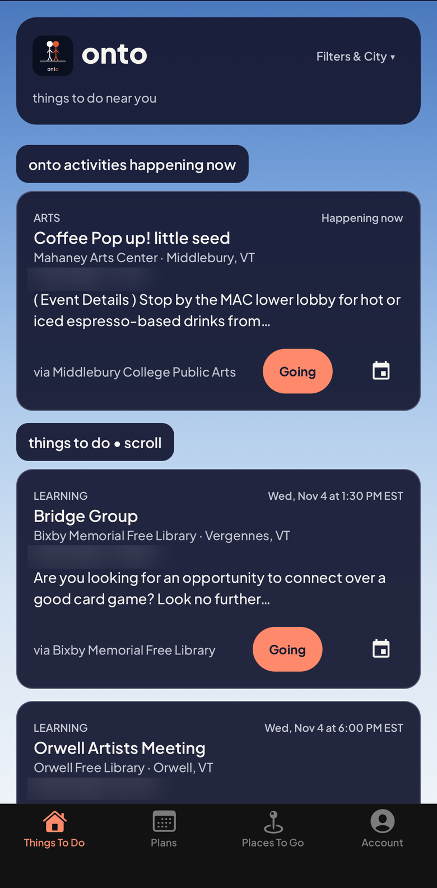
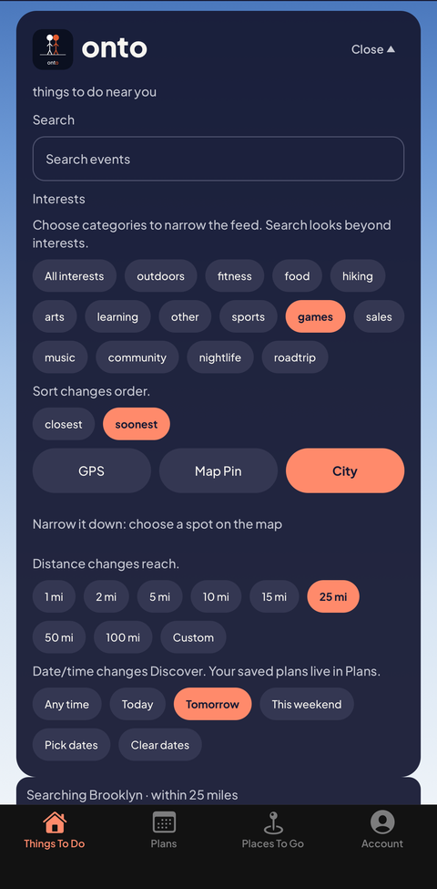
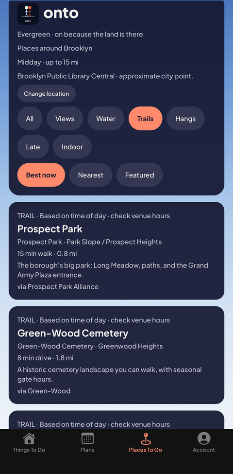

# onto

[](https://github.com/JamesTRichmond/onto-events/actions/workflows/ci.yml)

**What's happening near you, right now.** Concerts, trail runs, library talks, gallery openings, pulled from venues' own calendars.

**[Open onto → onto.events](https://onto.events)** · no account · no ads · installs from the browser like an app

<p>



</p>

> This is a public snapshot of the production app's source, published with fresh history so the work can be reviewed. Day-to-day development happens in a private repo. Internal planning documents and the curated source registry (which venues and calendars onto reads, and the discovery scripts that find them) are not included. All rights reserved; see [NOTICE.md](NOTICE.md).

## What it does

- A live feed of things to do near a city or a map pin, filtered by interest, distance and date.
- Events come straight from venue calendars (ICS, JSON-LD, FullCalendar, Squarespace, The Events Calendar) through an ingestion pipeline that normalizes, dedupes and validates them. Bundled feeds cover 20+ metros, from Brooklyn and Chicago to Montreal and Tokyo.
- Runs as a Progressive Web App: installable, works offline, client-side routing.

## Stack

TypeScript · React 19 · React Native 0.81 / Expo SDK 54 (web export) · Expo Router · Leaflet + OpenStreetMap · Supabase (Postgres, row-level security, Deno edge functions) · Jest · Cloudflare Pages

## Notable engineering

- **Privacy as a constraint.** Raw coordinates stay in memory for distance math and are never stored or sent to the event catalog. The one weather lookup sends a rounded 0.1° grid point, and a test fails if a request ever carries the real position. Details: [SAFETY.md](SAFETY.md), [PRIVACY.md](PRIVACY.md).
- **Safety designed before the social layer.** Mature content is unreachable without an explicit 21+ acknowledgement, family mode never shows connect features, and age is stored as a boolean, never a birthdate. Threat model in [SAFETY.md](SAFETY.md).
- **A night-owl calendar.** The day rolls over at 04:00, so 2 AM Friday still reads as Friday night.
- **Ingestion you can trust.** One schema for every source, duplicate detection, and test fixtures per calendar format (`scripts/pipeline/adapters/`, `scripts/pipeline/fixtures/`).
- **Database rules tested like code.** 8 SQL migrations with row-level security, plus database tests in `supabase/tests/`.
- **About 1,500 tests in 182 suites** across UI, data and pipeline, run in CI on every push.

## Run locally

```sh
npm ci
npm test
npx tsc --noEmit
npx expo start --web
```

Production build: `npm run build` (static web export plus service worker, in `dist/`).

## Layout

| Path | What's there |
|---|---|
| `app/` | Screens and routes (Expo Router) |
| `components/`, `hooks/`, `lib/` | UI, state and domain logic |
| `data/` | Bundled city feeds, venues and service regions |
| `scripts/pipeline/` | Calendar adapters, normalization and validation (source registry withheld) |
| `supabase/` | Migrations, RLS tests, edge functions |

## My role

Product, design and engineering, end to end. Built by James Richmond under AgentiCubed LLC, with AI coding agents working inside a written coordination policy: one integration owner, branch-per-task PRs, and every merge approved by me.

— [James Richmond](https://github.com/JamesTRichmond) · [jamestrichmond.com](https://jamestrichmond.com)
